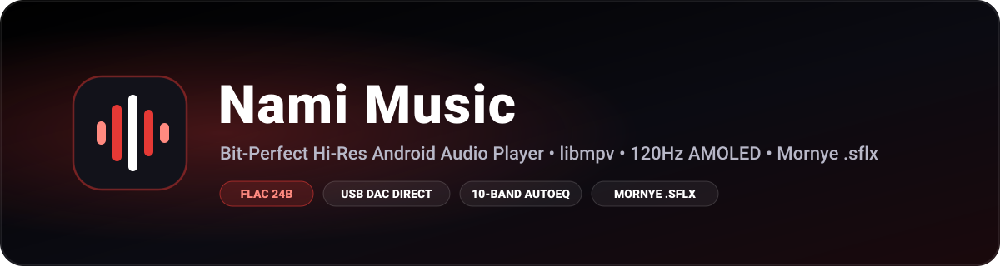

<p align="center">
  
</p>

<p align="center">
  <a href="https://github.com/Piyush1625/Nami-Music/releases/latest">
    
  </a>
  <a href="https://github.com/Piyush1625/Nami-Music/releases">
    
  </a>
  <a href="https://github.com/Piyush1625/Nami-Music/actions/workflows/build.yml">
    
  </a>
  <a href="LICENSE">
    
  </a>
</p>

<p align="center">
  <strong>Nami Music</strong> is an open-source Flutter Android music player engineered for <strong>bit-perfect USB DAC lossless playback</strong>, <strong>120Hz pitch-black AMOLED polish</strong>, <strong>in-file FLAC/MP3 tag editing</strong>, and <strong>Mornye <code>.sflx</code> extension discovery</strong>.
</p>

<p align="center">
  <a href="https://github.com/Piyush1625/Nami-Music/releases/latest"><strong>Download Latest Signed ARM64 APK</strong></a> •
  <a href="docs/SFLX_SPEC.md"><strong>Mornye .sflx Spec</strong></a> •
  <a href="CHANGELOG.md"><strong>Changelog</strong></a> •
  <a href="https://piyush1625.github.io/Nami-Music/"><strong>Project Site</strong></a>
</p>

---

## Highlights

| Area | Capabilities |
| :--- | :--- |
| **Audiophile Engine (`libmpv`)** | 16B / 24B FLAC, ALAC, WAV, MP3, M4A, OGG • Exclusive USB DAC permission (`UsbManager`) • Live Audio Path telemetry • 10-Band ISO Equalizer with **AutoEQ IEM profiles** (Harman IE, IEM Neutral, Studio DF) • True **Dual-Deck Overlapping Crossfade** (`0s–8s`) • Independent Pitch & Stereo L/R Balance |
| **Home & Analytics** | Customizable drag-to-reorder shelves • Live tappable DAC output & AutoEQ switcher • Time-of-Day & Forgotten Favorites mixes • Weekly Recap strip • Timestamped 7-day cadence, 28-day listening heatmap & active streak • **ListenBrainz** scrobbling with offline queue |
| **Tracks, Artists & Playlists** | Multi-criteria sort sheet & health filters (`Untagged`, `No Cover`, `Duplicates`) • Dual customizable swipe gestures • **Permanent in-file FLAC/MP3 tag & cover art writer** (`Isolate.run`) • Edge-to-edge parallax Artist Hero with chronological albums, Primary vs. Appears On split, Bio, and **Artist Alias/Merge Tool** • Rule-Based Smart Playlists, 2x2 mosaic collage covers, pins & auto `.m3u8` sync |
| **Mornye `.sflx` Ecosystem** | Interactive Album & Artist drill-down with **Download Entire Album** • Queued background Download Manager with progress, auto-cover & LRCLIB `.lrc` embedding • Folder/filename templates • Extension Store directory & live latency pings • Direct **Stream-to-Queue** playback |
| **Minimal Settings & Updates** | Category-based pitch-black Settings with top search bar, live permission/cache status dots, one-tap **Bit-Perfect vs. Tuned** presets, Appearance live preview, unified `.nami-backup` archive, and an **in-app GitHub Releases updater** |

---

## Screenshots

> Add your phone screenshots into `assets/screenshots/` (`home.png`, `now_playing.png`, `artist.png`, `settings.png`) to display them here.

| Home | Now Playing | Artist Parallax | Minimal Settings |
| :---: | :---: | :---: | :---: |
| `assets/screenshots/home.png` | `assets/screenshots/now_playing.png` | `assets/screenshots/artist.png` | `assets/screenshots/settings.png` |

---

## Installation & In-Place Updates

### Direct APK Download
1. Open [**Releases**](https://github.com/Piyush1625/Nami-Music/releases/latest) and download `nami-arm64-v8a.apk`.
2. Install directly over any previous signed Nami release—your playlists, listening history, and settings stay intact.
3. Grant **All Files Access** (`MANAGE_EXTERNAL_STORAGE`) inside **Settings -> Permissions & Hardware** for permanent in-file tag editing and deletion.

### Track Updates with Obtainium
Paste this JSON into **Obtainium -> Import / Add App** to receive automatic signed release updates:

```json
{
  "id": "com.piyush.nami",
  "url": "https://github.com/Piyush1625/Nami-Music",
  "author": "Piyush1625",
  "name": "Nami Music",
  "additionalSettings": "{\"apkFilterRegEx\":\"arm64-v8a\\\\.apk$\",\"includePrereleases\":false}"
}
```

---

## Building Mornye `.sflx` Extensions

Mornye supports standalone `.sflx` JSON manifests, repo indexes, and `.zip` extension bundles.
* Read the full schema in [**`docs/SFLX_SPEC.md`**](docs/SFLX_SPEC.md).
* Copy starter templates from [**`examples/sample_provider.sflx`**](examples/sample_provider.sflx) and [**`examples/sample_repo_index.json`**](examples/sample_repo_index.json).

---

## Repository Architecture

```text
├── .github/workflows/build.yml      # Fast analyze gate + cached ARM64 build + auto GitHub Releases
├── .github/ISSUE_TEMPLATE/          # Structured Bug Report & Feature Request forms
├── android/app/proguard-rules.pro   # R8 shrinking keep-rules for libmpv, audio_service & USB DAC
├── assets/                          # Vector waveform banner & app screenshots
├── docs/                            # GitHub Pages landing site (index.html) & SFLX_SPEC.md
├── examples/                        # Sample .sflx extension manifests
├── fastlane/metadata/android/en-US/ # IzzyOnDroid / F-Droid storefront metadata
├── lib/
│   ├── main.dart                    # App entry, NamiApp & NamiHomeShell
│   ├── models/nami_models.dart      # AudioTrack, CustomPlaylist, Mornye & Lyrics models
│   ├── screens/                     # Modular Settings & Now Playing screens
│   ├── services/                    # Tag Writer, Crossfade Engine, Download Manager, Scrobbler, Store, Updater
│   └── widgets/nami_widgets.dart    # HuePaletteCanvas, FastScroller, AnimatedPlayingBars & Skeletons
└── scripts/configure_android_native.py
```

---

## Single-Branch Release Workflow (Termux)

```bash
# Regular development push on main:
cd ~/nami && git add -A && git commit -m "Your change" && git push origin main

# Cut a signed GitHub Release (triggers auto-publish to Releases & In-App Updater):
git tag v2.1.0 && git push origin v2.1.0
```

---

## Author & License

Created and maintained by **Piyush ([Piyush1625](https://github.com/Piyush1625))**.
Released under the [**MIT License**](LICENSE).
